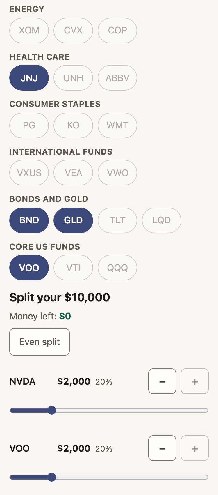
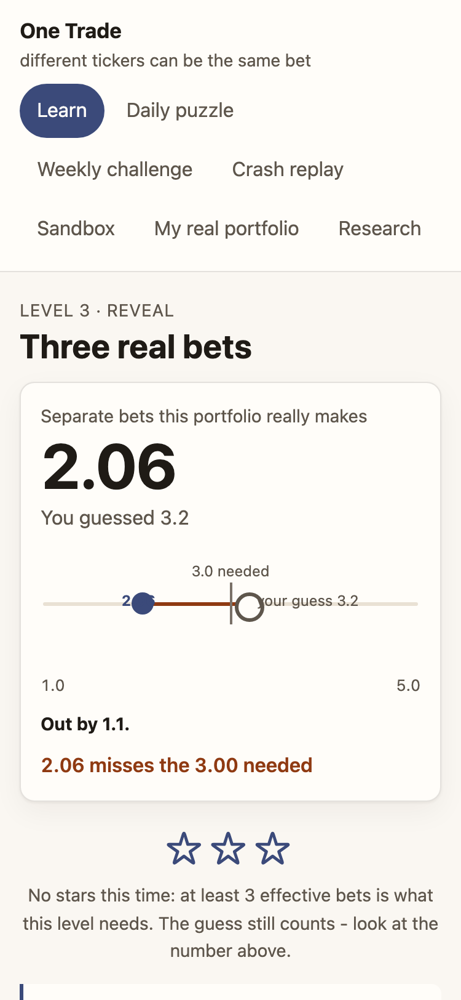

# One Trade

**Build a portfolio with $10,000 of pretend money, guess how many bets you actually made, and find out from real market data.**

[**Play it →**](https://mayaagge.github.io/one-trade/)

No sign-up, no accounts, nothing installed. A round takes one to two minutes.

It teaches one idea: **different tickers can be the same bet.** An S&P 500 fund, a tech fund and NVIDIA rise and fall together, so holding all three is closer to one trade than to three. That is the name.

*Educational, not investment advice.*

| Build it | Find out |
| --- | --- |
|  |  |
| Pick holdings and split $10,000 between them. | Guess first, then see the real answer worked out from price history. |

---

## Why it exists

Most stock games ask "can you pick winners?" This one asks "do you know what you're actually betting on?" Returns never score points, and there is no leaderboard — the only thing it rewards is understanding where your risk actually sits.

The measure behind it is the **effective number of bets** (Meucci 2009): split the covariance matrix of daily returns into principal components, work out each component's share of total variance, and take the exponential of the entropy of those shares. Five holdings that all move together score close to 1. Five that genuinely behave differently score close to 5. All of it runs in your browser.

## The research, and what it actually found

Three hypotheses were written down and **tagged in git before a single price was downloaded** (`prereg`, `prereg-v2`, `prereg-v3`). The tag timestamps precede the first commit containing price data, which anyone can check. Every result is published whichever way it came out — including the two below that went against the claim.

**Hypothesis 1 — hidden concentration.** *Claim: a beginner combining a broad index fund, a tech fund and individual AI stocks has far fewer independent sources of risk than holdings.*

**The verdict is "not supported".** Two tests were run and both are published, but they are not equals: the headline test carries the verdict, and the registered one is printed beside it because it is what was registered, not because it decides anything ([PREREG_AMENDMENT_2.md](PREREG_AMENDMENT_2.md) §5, written before any price was downloaded).

| Test | Beginner median | Threshold | Verdict | Role |
| --- | --- | --- | --- | --- |
| Headline: correlation-only ratio R | 0.773 | below 0.60 | **not supported** | **the verdict** |
| Registered: effective risk sources ÷ holdings | 0.327 | below 0.60 | supported | reported as registered |

**Why they disagree.** Both ask "how much less diversified is this than it looks?", but they divide by different things. The registered test divides effective bets by the *number of holdings* — and that falls for two unrelated reasons at once: holdings moving together, and money spread unevenly. The sampler spreads money very unevenly on purpose, and a portfolio with most of its money in one name has few effective bets however its holdings move. **The giveaway is the independence benchmark: run the same sampler on holdings with no correlation whatsoever and the median still lands at 0.523 — already under the 0.60 bar.** That test is passed before correlation enters the room, so "supported" there is not on its own evidence for the claim.

The headline test removes exactly that confusion: it compares each portfolio against *itself* with correlations switched off, holding the same weights and the same volatilities, so the weights cancel out and only correlation is left. Measured that way, correlation costs about a quarter — 0.773, against a bar of 0.60 — and the claim does not hold.

Two further honest marks against it: the headline test did **not** separate the beginner set from the diversified control set (0.773 against 0.844, a gap of 0.072, short of the 0.100 required before claiming separation), and a disagreement between two measures is itself a result — it says they answer different questions, and it is not resolved by picking the more flattering one.

**Hypothesis 2 — a tightening market.** *Claim: AI stocks move more closely with the broad market now than they did before the AI trade.*

**Not supported — and it went the other way.** Correlation between the equal-weight AI basket and the equal-weight S&P 500 (RSP) *fell* from **0.527** in the earliest 12 months to **0.473** in the most recent twelve: a difference of **−0.054**, where the test needed +0.10. The 90% block-bootstrap interval is [−0.273, +0.052], which contains zero.

**Hypothesis 3 — players learn.** **Collecting.** No player data exists yet; collection closes 60 days after launch, and needs 60 players reaching level 7 before it can be computed at all.

**Robustness:** both hypotheses were rerun 13 times, dropping one AI basket name each time. No single stock changes a verdict.

Full methods, thresholds, windows and limitations: [`PREREG.md`](PREREG.md) (frozen), its three amendments, and [`docs/PRD.md`](docs/PRD.md). Read them before trusting any number here — the known weaknesses are listed explicitly, including that Hypothesis 3 has no control group and that today's AI leaders were picked before their past was measured.

## Reproducing the verdicts

Every published verdict comes from the committed snapshot `data/prices.json`, never a fresh download — Yahoo's adjusted closes for dividend payers are not reproducible between fetches (refetching KO disagreed with the snapshot on 1,731 of 2,513 days, by up to 8.1e-7 relative). `scripts/run_research.mjs` reads that file and no other, and records its SHA-256 in `data/results.json`:

```
ec4a34cc67ae086325e0c782ea8e4fd9fcc77705ed048c48dd9f795d163e1605
```

```bash
node scripts/run_research.mjs      # rewrites data/results.json from the snapshot
```

## How to run locally

Needs Node 24+ and Python 3. No build step, no bundler, no framework — it is plain HTML, CSS and JavaScript.

```bash
git clone git@github.com:mayaagge/one-trade.git
cd one-trade
python3 -m http.server 8000        # then open http://localhost:8000
```

Tests:

```bash
node --test "tests/**/*.test.js"   # 1,187 tests
```

The browser maths is checked against numpy known-answer fixtures to 1e-9. To regenerate those fixtures you need numpy in a virtualenv:

```bash
python3 -m venv .venv && .venv/bin/pip install numpy
npm run fixtures
```

Other useful commands:

```bash
node scripts/check_levels.mjs      # every level still has winning designs
node scripts/check_weekly.mjs      # the weekly challenge is still passable
```

## What leaves the browser

Two kinds of anonymous record go to a Cloudflare Worker, and nothing else ever:

- **A count ping:** the level reached, and the source code from the link that brought you (`?src=club-ucla`). No identifier of any kind.
- **A guess record:** a random per-browser ID, the level, the guess, the actual answer, and the date. Five fields, exactly, and a test fails the build if a sixth appears.

No tickers, no dollar amounts, no weights, no names, no emails, no IP addresses stored. Your portfolios, stars and progress stay in your own browser's storage, and the game works without that storage at all. Breaking the Worker entirely changes nothing a player can see — there is a test for that too.

The whole Worker is [`worker/src/index.js`](worker/src/index.js) and [`worker/src/validate.js`](worker/src/validate.js) — around 240 lines, mostly comments and input validation — and it holds no secret.

## Layout

| Path | What's in it |
| --- | --- |
| `index.html`, `css/`, `js/` | The game. All maths runs in the browser |
| `js/math.js` | Effective bets, risk shares, beta, correlation |
| `js/returns.js` | The snapshot turned into date-aligned daily returns |
| `worker/` | The Cloudflare Worker: two anonymous analytics routes |
| `data/prices.json` | The frozen research snapshot. Written once, never touched |
| `data/game.json` | What the game plays on, refreshed every weekday evening |
| `levels.json`, `basket.json`, `tickers.json` | Every rule, threshold and ticker, as readable JSON |
| `scripts/` | Data fetch, research runner, level solvability checks |
| `tests/` | Known-answer maths tests and everything else |
| `docs/PRD.md` | The specification |
| `BUILD_LOG.md` | What was built, what broke, and what was wrong about it |

## Credits and licence

Built by [Maya Agge](https://github.com/mayaagge). Market data from Yahoo Finance via an unofficial endpoint, labelled as unofficial educational data throughout.

Measure from Meucci, A. (2009), "Managing Diversification", *Risk* 22(5).

**Educational, not investment advice.** Nothing here is a recommendation to buy or sell anything, and the pretend money is pretend.
